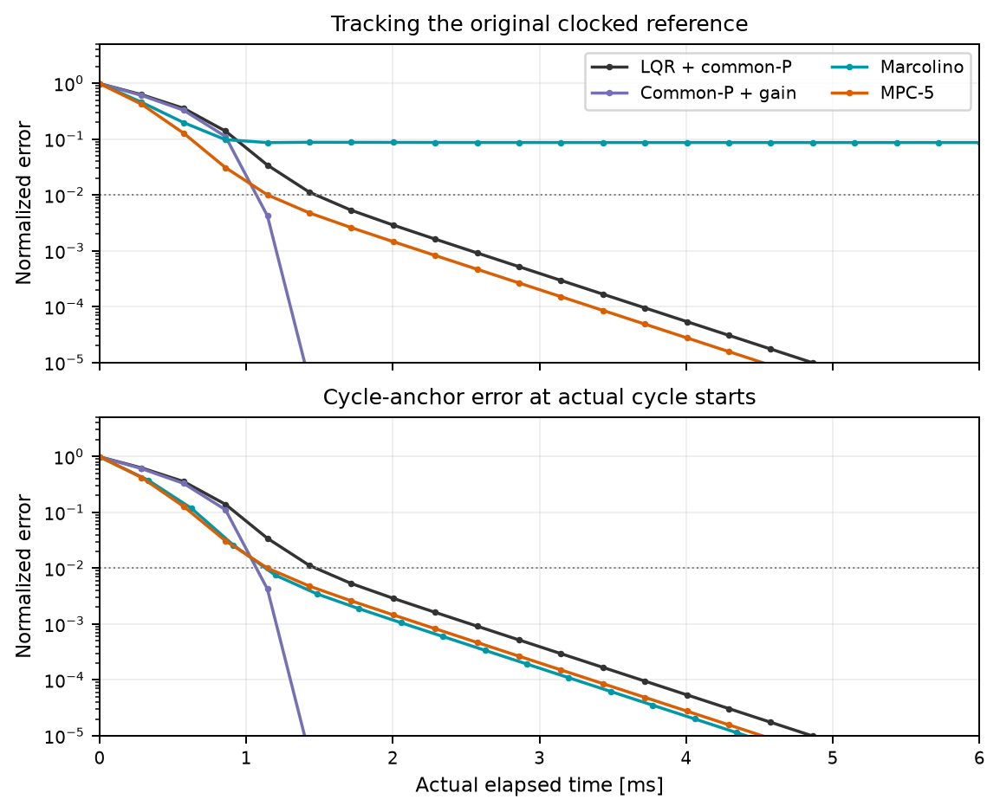
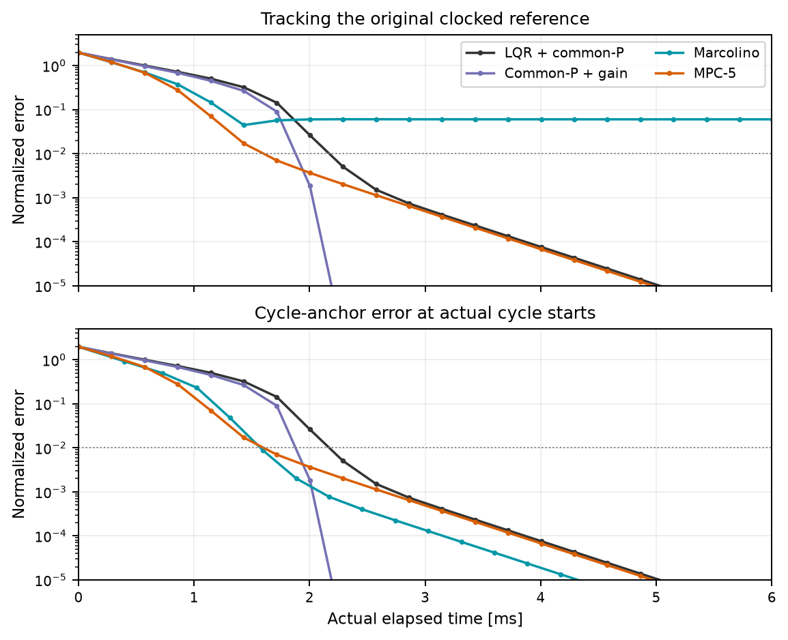
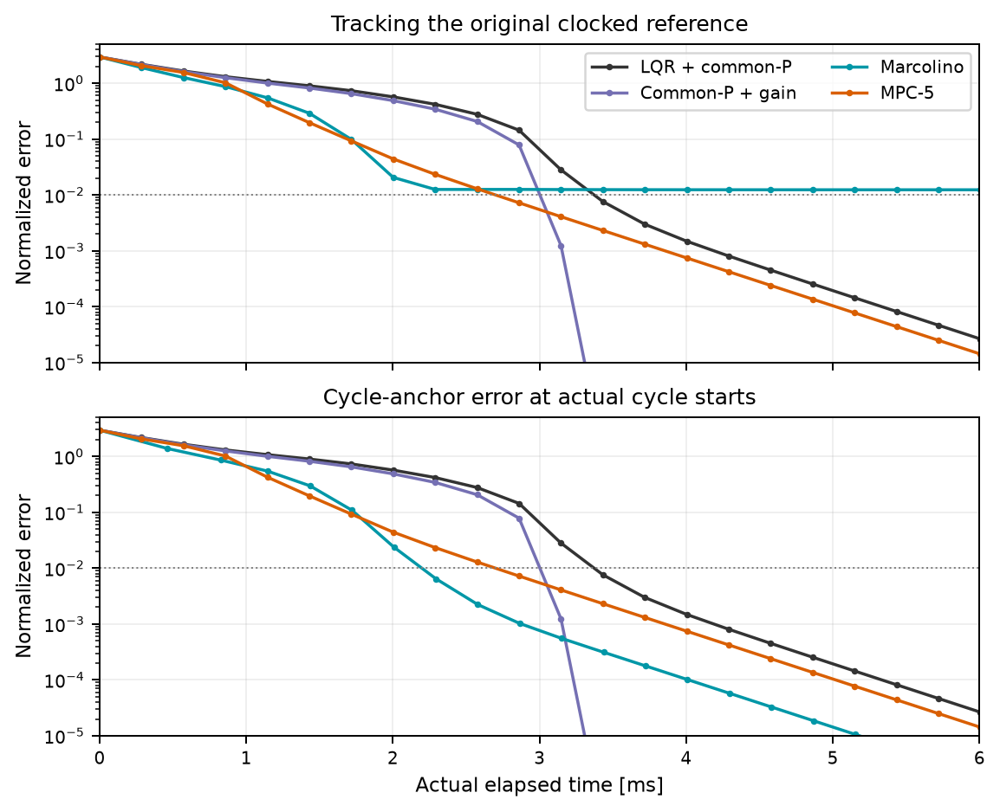

# Four-method comparison

The comparison uses only the original 1x, 2x and 3x cases, where matching saved MPC-5 evidence exists. Each method uses the same converter and nominal schedule, with T=286 us and minimum applied dwell 3 us. State errors use the scale diag(10,20,1), and timing offsets use the 10 us scale. The 2x and 3x starts have negative current and are mathematical stress tests. No optimization or simulation was rerun for this document.

## Methods

- **LQR + common-P.** Current LQR gain, checked afterward with a common-P certificate. Uniform scaling preserves the period.

- **Common-P + gain.** The original saved gain and certificate designed jointly in the Common-P synthesis study. Uniform scaling preserves the period.

- **Marcolino.** Current LQR gain with sequential boundary delays. The cycle can extend; the existing common-P guarantee does not cover this rule.

- **MPC-5.** The unchanged five-cycle constrained switching-time MPC reference. Its native terminal ingredients are retained; it is not checked by the common-P test here.

## Reading the comparison

Anchor n/ms gives the sustained anchor-threshold cycle and its actual elapsed time. Clock ms uses identical samples at j*T against the original clocked reference. The threshold is normalized error below 0.01, maintained through the rest of the saved horizon. A dash means it was not sustained. Final clock error is measured at 28.6 ms. Plots show the first 6 ms of the saved 100-cycle responses. Each curve keeps its recorded sampling times.

J100 sums squared normalized anchor error and 0.001 times squared normalized applied interior timing offsets over 100 actual cycles. It excludes MPC's terminal penalty and does not penalize Marcolino's extra terminal extension. Because Marcolino samples different physical times and phases, its anchor J100 is not a fair common-clock tracking cost.

The common-P guarantee covers the conditioned linearized families of the two uniformly scaled gains, not global nonlinear stability. Marcolino is outside that guarantee. MPC-5 is an unchanged reference, not a newly common-P-certified controller. All reported nonlinear responses are simulation evidence. No hardware deadline or state-safety claim is made.

## 1x initial error

| Method | J100 | Anchor n/ms | Clock ms | Final clock err | Min dwell us |
|---|---|---|---|---|---|
| LQR + common-P | 1.5456 | 6 / 1.716 | 1.716 | 1.68e-15 | 3.000 |
| Common-P + gain | 1.5096 | 4 / 1.144 | 1.144 | 7.9e-16 | 3.000 |
| Marcolino | 1.2659 | 4 / 1.197 | -- | 0.0868 | 3.000 |
| MPC-5 | 1.3099 | 5 / 1.430 | 1.430 | 3.21e-10 | 3.000 |

## 2x initial error

| Method | J100 | Anchor n/ms | Clock ms | Final clock err | Min dwell us |
|---|---|---|---|---|---|
| LQR + common-P | 7.8071 | 8 / 2.288 | 2.288 | 1.68e-15 | 3.000 |
| Common-P + gain | 7.5465 | 7 / 2.002 | 2.002 | 7.9e-16 | 3.000 |
| Marcolino | 5.5325 | 5 / 1.597 | -- | 0.0602 | 3.000 |
| MPC-5 | 6.2892 | 6 / 1.716 | 1.716 | 2.52e-10 | 3.000 |

## 3x initial error

| Method | J100 | Anchor n/ms | Clock ms | Final clock err | Min dwell us |
|---|---|---|---|---|---|
| LQR + common-P | 21.0741 | 12 / 3.432 | 3.432 | 1.68e-15 | 3.000 |
| Common-P + gain | 20.1221 | 11 / 3.146 | 3.146 | 8.71e-16 | 3.000 |
| Marcolino | 12.9644 | 7 / 2.293 | -- | 0.0124 | 3.000 |
| MPC-5 | 17.5213 | 10 / 2.860 | 2.860 | 2.91e-10 | 3.000 |

Marcolino's small error at its actual final cycle boundary is sampled at a different phase. Its error on the shared nominal final clock remains above 0.01, as shown in the table.

## Source evidence

Filtered from [the validated comparison](results/comparison.json) and its [independent validation](results/validation.json). MPC-5 times, errors and costs are additionally checked against its saved fixed-period history. The full report is unchanged.
