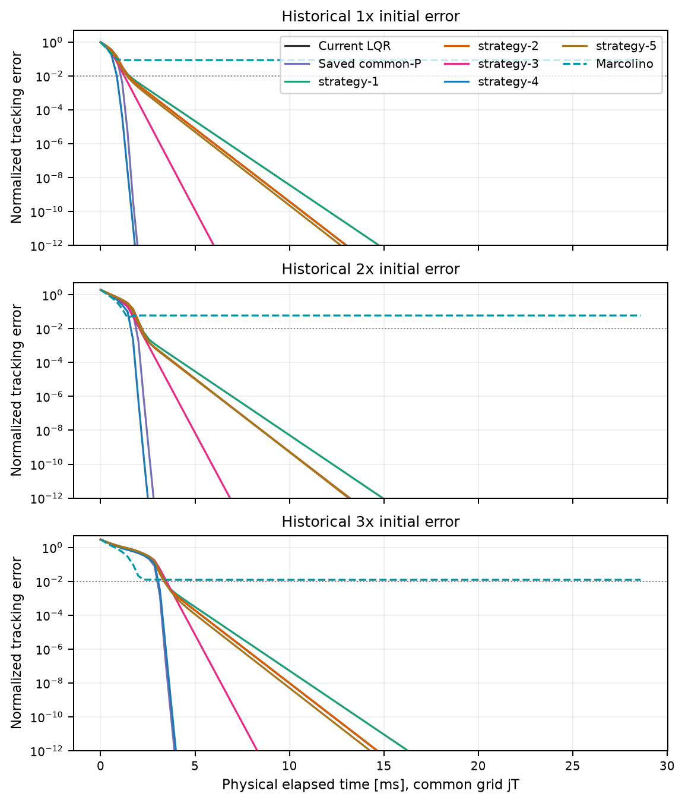
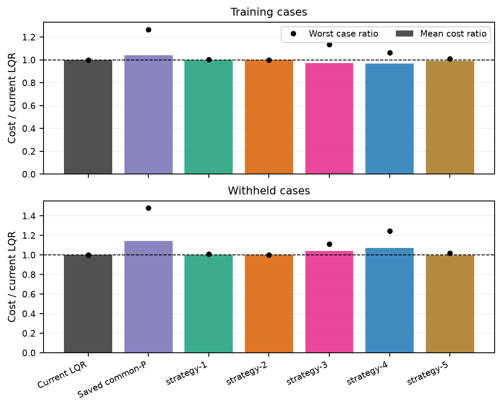
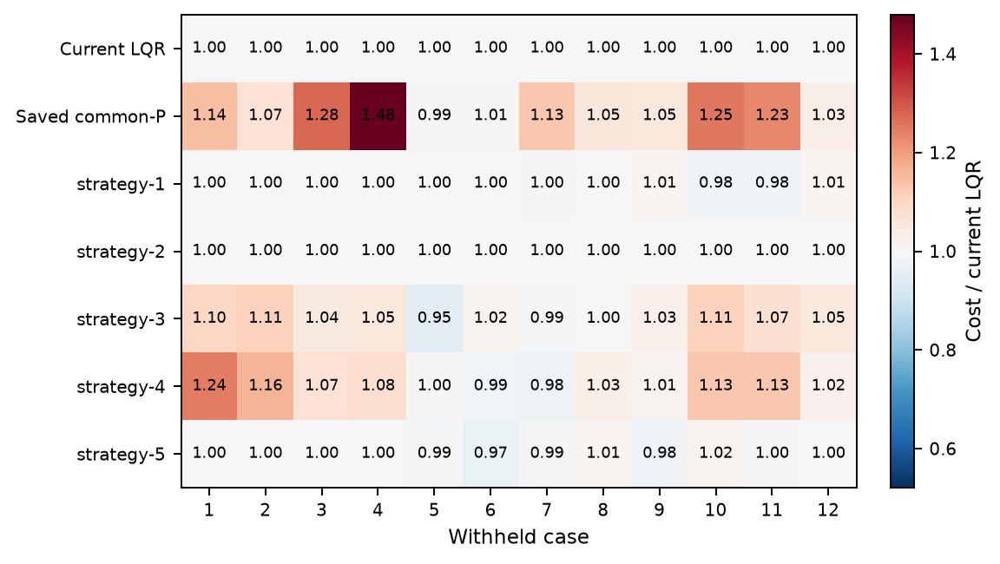
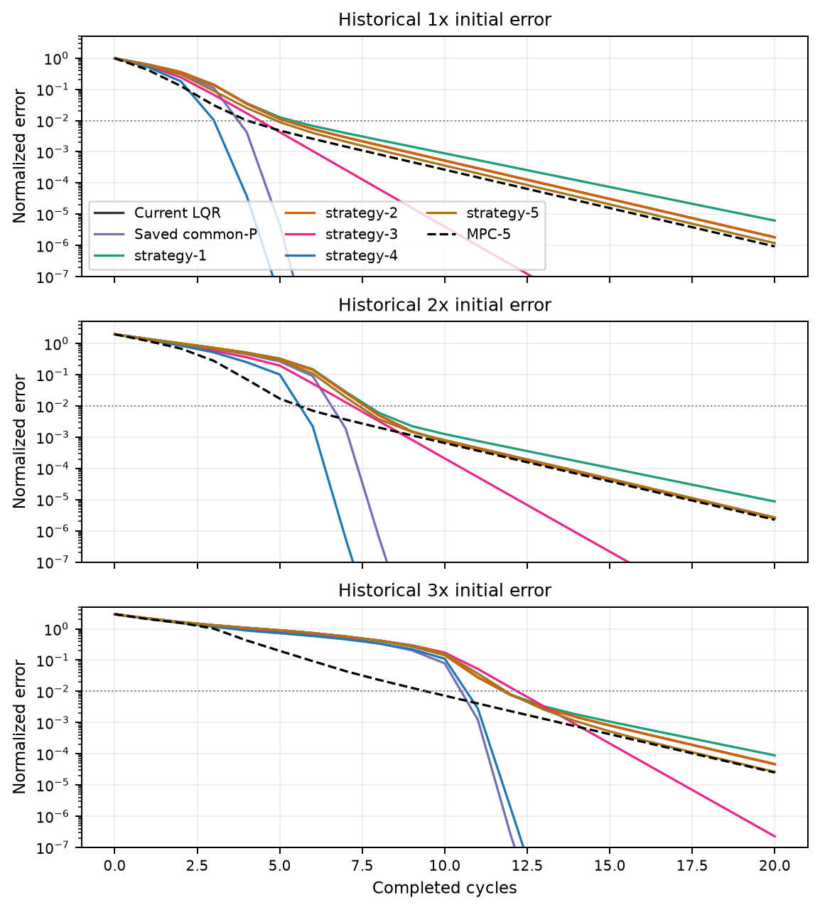
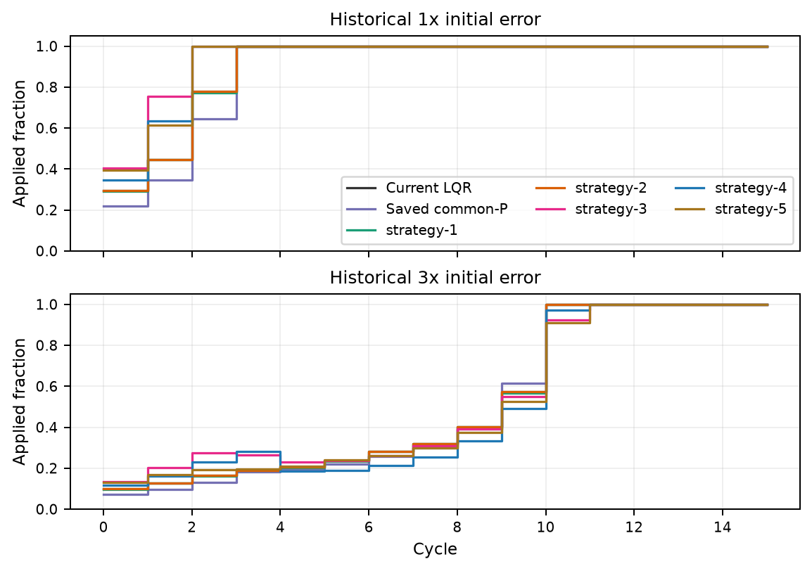

# Five certified gain strategies and Marcolino reference

strategy-5 has the lowest mean withheld cost among the five strategies. Its mean cost is 0.33% lower than current LQR. It has 6 of 12 withheld cases with higher cost than LQR, and its worst case costs 1.017 times LQR. The saved Common-P gain has mean withheld cost ratio 1.143. The mean improvement is a tradeoff, not uniform dominance. strategy-4 reaches the threshold in 3.42 cycles on average, versus 5.33 for LQR, but its mean withheld cost ratio is 1.070.

The best-strategy conclusion uses only the five certified, fixed-period gain optimizations. Marcolino is compared separately on the common physical clock below.

## Comparison protocol

Six predeclared training cases selected each strategy's gain. Twelve different cases were withheld from optimization. The historical 2x and 3x cases are separate stress tests and start with negative current. The seven certified fixed-period methods use the same 100-cycle cost, with Q=I and applied timing weight 0.001. They use constant gains and the same scalar dwell conditioner. Marcolino is a separate variable-period conditioning reference with unchanged current LQR gain, no scalar beta and no gain optimization. The five optimization records and gains remain frozen. Optimization and exact-plant evaluation ran in Julia; Python independently checked the saved evidence. The five strategy runs were parallel, so their elapsed times include compilation and resource contention and are not controlled algorithm benchmarks.

## Eight-method common-clock comparison

Marcolino uses the unchanged current LQR gain with sequential boundary delays and a 3 us minimum dwell. The next cycle starts at the realized terminal boundary, so its period can grow. There is no scalar beta, gain optimization or common-P certificate for this policy. The seven certified methods retain the fixed nominal period. All eight are compared at the same 101 physical times j*T through 28.600 ms. States at these times come from exact partial propagation, not interpolation. The tracking sum adds squared normalized errors at j=0,...,99 against the original periodic reference. It charges no input effort and is neither J100 nor a physical energy measure. It is a sampled comparison, not a continuous-time tracking bound. Ratios use current LQR in the same case. Fixed-clock threshold time is the first common-grid time after which error stays below 0.01 for the rest of the saved grid. A dash means no sustained crossing; a mean or maximum threshold time is then also unavailable.

Marcolino's mean withheld tracking-sum ratio is 0.9538. It has no sustained fixed-clock threshold crossing in 2 of 12 withheld cases and 3 of the three historical cases. A smaller tracking sum and a sustained threshold crossing are different performance measures. Neither changes the fixed-period certified gain ranking.

### Twelve withheld cases

Mean and worst ratios refer to the tracking-only sum. Mean ms and Max ms refer to sustained fixed-clock threshold time; Misses counts cases without a crossing.

| Method | Mean ratio | Worst ratio | Mean ms | Max ms | Misses |
|---|---|---|---|---|---|
| Current LQR | 1.0000 | 1.0000 | 1.525 | 2.002 | 0 |
| Saved common-P | 1.0258 | 1.2817 | 1.001 | 2.002 | 0 |
| strategy-1 | 1.0032 | 1.0252 | 1.644 | 2.288 | 0 |
| strategy-2 | 1.0000 | 1.0000 | 1.525 | 2.002 | 0 |
| strategy-3 | 0.9894 | 1.1126 | 1.144 | 1.430 | 0 |
| strategy-4 | 0.9949 | 1.1538 | 0.977 | 1.716 | 0 |
| strategy-5 | 0.9916 | 1.0220 | 1.525 | 2.002 | 0 |
| Marcolino | 0.9538 | 1.2330 | -- | -- | 2 |

Historical 1x, 2x and 3x errors below use the common clock and the original periodic reference. The horizontal axis is physical elapsed time, not each policy's cycle count. MPC-5 is omitted because its imported record has no validated common-clock samples.

### Policy duration and reference phase

The following duration and phase statistics cover all 20 cases per method. Max ms is the elapsed time of 100 actual cycles; Max cycle us is the longest realized cycle. Extended counts extended cycles across all 2,000 cycles per method. Max phase err is the largest final error against the original periodic reference evaluated at each method's actual final boundary. Anchor error instead compares a cycle-start state with the nominal anchor regardless of elapsed phase. A delayed policy can approach that anchor while remaining out of phase with the reference. Anchor threshold times therefore do not establish faster fixed-clock tracking. In the 3x case, Marcolino's final actual-boundary reference error is 0.00494, but its error at the shared nominal final time is 0.01237. The sample phases differ, which explains the different threshold outcomes.

| Method | Max ms | Max cycle us | Extended | Max phase err |
|---|---|---|---|---|
| Current LQR | 28.600 | 286.000 | 0 | 1.75e-15 |
| Saved common-P | 28.600 | 286.000 | 0 | 1.05e-15 |
| strategy-1 | 28.600 | 286.000 | 0 | 1.75e-15 |
| strategy-2 | 28.600 | 286.000 | 0 | 1.75e-15 |
| strategy-3 | 28.600 | 286.000 | 0 | 1.37e-15 |
| strategy-4 | 28.600 | 286.000 | 0 | 9.19e-16 |
| strategy-5 | 28.600 | 286.000 | 0 | 1.63e-15 |
| Marcolino | 28.891 | 462.479 | 14 | 0.106 |

### Matched historical tracking and thresholds

These matched historical cases show the tracking sum and its LQR ratio, fixed-clock threshold time in ms, actual anchor threshold cycle / elapsed ms, and final phase-sensitive error at the actual 100th-cycle boundary. Ext counts extended cycles in each trajectory. All crossings are sustained only over their saved sampling horizons. The 1x case was in training; 2x and 3x were stress tests, not optimization inputs.

#### Historical 1x

| Method | Sum | Ratio | Fixed ms | Anchor n/ms | Phase err | Ext |
|---|---|---|---|---|---|---|
| Current LQR | 1.5044 | 1.0000 | 1.716 | 6 / 1.716 | 1.68e-15 | 0 |
| Saved common-P | 1.4546 | 0.9669 | 1.144 | 4 / 1.144 | 7.9e-16 | 0 |
| strategy-1 | 1.5068 | 1.0016 | 1.716 | 6 / 1.716 | 1.75e-15 | 0 |
| strategy-2 | 1.5044 | 1.0000 | 1.716 | 6 / 1.716 | 1.68e-15 | 0 |
| strategy-3 | 1.3570 | 0.9020 | 1.430 | 5 / 1.430 | 1.24e-15 | 0 |
| strategy-4 | 1.2691 | 0.8436 | 1.144 | 4 / 1.144 | 9.19e-16 | 0 |
| strategy-5 | 1.4170 | 0.9419 | 1.430 | 5 / 1.430 | 1.6e-15 | 0 |
| Marcolino | 1.9483 | 1.2951 | -- | 4 / 1.197 | 0.0505 | 2 |

#### Historical 2x

| Method | Sum | Ratio | Fixed ms | Anchor n/ms | Phase err | Ext |
|---|---|---|---|---|---|---|
| Current LQR | 7.7400 | 1.0000 | 2.288 | 8 / 2.288 | 1.68e-15 | 0 |
| Saved common-P | 7.4610 | 0.9640 | 2.002 | 7 / 2.002 | 7.9e-16 | 0 |
| strategy-1 | 7.7519 | 1.0015 | 2.288 | 8 / 2.288 | 1.68e-15 | 0 |
| strategy-2 | 7.7400 | 1.0000 | 2.288 | 8 / 2.288 | 1.68e-15 | 0 |
| strategy-3 | 7.0514 | 0.9110 | 2.288 | 8 / 2.288 | 1.15e-15 | 0 |
| strategy-4 | 6.6354 | 0.8573 | 1.716 | 6 / 1.716 | 9.19e-16 | 0 |
| strategy-5 | 7.4438 | 0.9617 | 2.288 | 8 / 2.288 | 1.63e-15 | 0 |
| Marcolino | 6.2788 | 0.8112 | -- | 5 / 1.597 | 0.106 | 3 |

#### Historical 3x

| Method | Sum | Ratio | Fixed ms | Anchor n/ms | Phase err | Ext |
|---|---|---|---|---|---|---|
| Current LQR | 20.9875 | 1.0000 | 3.432 | 12 / 3.432 | 1.68e-15 | 0 |
| Saved common-P | 20.0165 | 0.9537 | 3.146 | 11 / 3.146 | 8.71e-16 | 0 |
| strategy-1 | 21.0076 | 1.0010 | 3.432 | 12 / 3.432 | 1.68e-15 | 0 |
| strategy-2 | 20.9875 | 1.0000 | 3.432 | 12 / 3.432 | 1.68e-15 | 0 |
| strategy-3 | 20.0689 | 0.9562 | 3.718 | 13 / 3.718 | 1.11e-15 | 0 |
| strategy-4 | 18.8216 | 0.8968 | 3.146 | 11 / 3.146 | 5.77e-16 | 0 |
| strategy-5 | 20.6549 | 0.9842 | 3.432 | 12 / 3.432 | 1.63e-15 | 0 |
| Marcolino | 15.0810 | 0.7186 | -- | 7 / 2.293 | 0.00494 | 4 |

### Anchor-sampled objective over different elapsed times

Each cell below is anchor-sampled J100 / actual elapsed ms for 100 cycles. J100 includes the original weighted applied timing term. Marcolino's anchor J100 spans a different elapsed time and samples a different reference phase, so it is not a fair common-clock tracking cost. These values do not enter the certified optimization rankings or the fixed-period best-strategy conclusion.

| Method | 1x J100 / ms | 2x J100 / ms | 3x J100 / ms |
|---|---|---|---|
| Current LQR | 1.5456 / 28.600 | 7.8071 / 28.600 | 21.0741 / 28.600 |
| Saved common-P | 1.5096 / 28.600 | 7.5465 / 28.600 | 20.1221 / 28.600 |
| strategy-1 | 1.5477 / 28.600 | 7.8182 / 28.600 | 21.0935 / 28.600 |
| strategy-2 | 1.5456 / 28.600 | 7.8071 / 28.600 | 21.0741 / 28.600 |
| strategy-3 | 1.4515 / 28.600 | 7.2054 / 28.600 | 20.2511 / 28.600 |
| strategy-4 | 1.3926 / 28.600 | 6.8564 / 28.600 | 19.0945 / 28.600 |
| strategy-5 | 1.4711 / 28.600 | 7.5255 / 28.600 | 20.7557 / 28.600 |
| Marcolino | 1.2659 / 28.653 | 5.5325 / 28.767 | 12.9644 / 28.891 |

## Certified fixed-period training and withheld performance

All cost ratios use current LQR as 1. Smaller is better. Regressions count withheld cases above LQR. Max cycles is the worst sustained threshold crossing.

| Method | Train J | Test J | Worst J | Worse cases | Mean cycles | Max cycles |
|---|---|---|---|---|---|---|
| Current LQR | 1.0000 | 1.0000 | 1.0000 | 0 | 5.33 | 7 |
| Saved common-P | 1.0428 | 1.1432 | 1.4792 | 11 | 3.50 | 7 |
| strategy-1 | 0.9987 | 0.9995 | 1.0110 | 9 | 5.75 | 8 |
| strategy-2 | 1.0000 | 1.0000 | 1.0000 | 0 | 5.33 | 7 |
| strategy-3 | 0.9741 | 1.0423 | 1.1107 | 9 | 4.00 | 5 |
| strategy-4 | 0.9699 | 1.0704 | 1.2436 | 10 | 3.42 | 6 |
| strategy-5 | 0.9914 | 0.9967 | 1.0172 | 6 | 5.33 | 7 |

### Why faster settling can cost more

The following withheld averages split J100 into tracking error and weighted applied timing effort. Each part is divided by the same current-LQR total cost, so the columns add to the mean cost ratio.

| Method | Error part | Timing part | Total |
|---|---|---|---|
| Current LQR | 0.8684 | 0.1316 | 1.0000 |
| Saved common-P | 0.8941 | 0.2492 | 1.1432 |
| strategy-1 | 0.8709 | 0.1286 | 0.9995 |
| strategy-2 | 0.8684 | 0.1316 | 1.0000 |
| strategy-3 | 0.8594 | 0.1829 | 1.0423 |
| strategy-4 | 0.8644 | 0.2059 | 1.0704 |
| strategy-5 | 0.8608 | 0.1359 | 0.9967 |

## Matched historical cases

Each cell gives J100 / sustained threshold cycle. The 1x case was in training; 2x and 3x were not.

| Method | 1x cost / cycles | 2x cost / cycles | 3x cost / cycles |
|---|---|---|---|
| Current LQR | 1.5456 / 6 | 7.8071 / 8 | 21.0741 / 12 |
| Saved common-P | 1.5096 / 4 | 7.5465 / 7 | 20.1221 / 11 |
| strategy-1 | 1.5477 / 6 | 7.8182 / 8 | 21.0935 / 12 |
| strategy-2 | 1.5456 / 6 | 7.8071 / 8 | 21.0741 / 12 |
| strategy-3 | 1.4515 / 5 | 7.2054 / 8 | 20.2511 / 13 |
| strategy-4 | 1.3926 / 4 | 6.8564 / 6 | 19.0945 / 11 |
| strategy-5 | 1.4711 / 5 | 7.5255 / 8 | 20.7557 / 12 |
| MPC-5 | 1.3099 / 5 | 6.2892 / 6 | 17.5213 / 10 |

## Strategies and selected settings

### strategy-1

LQR weights are tuned, with a separate common-P check for every candidate. Training cost ratio 0.998749; 46 objective evaluations, 45 solver calls, 0 numerical or feasibility rejections. Status: improved training score. Termination: Completed 27-point coarse grid and six clipped coordinate proposals at each of 0.5, 0.25, 0.125; duplicates reused from cache.

Selected (a,b,c)=[0, -0.125, 0].

Full record: [results/strategy-1.json](results/strategy-1.json).

### strategy-2

The gain and a full-feedback quadratic cost bound are synthesized together. The shared certificate also covers the open endpoint. The cost bound itself does not cover conditioned nonlinear operation. Training cost ratio 1.000000; 7 objective evaluations, 9 solver calls, 3 numerical or feasibility rejections. Status: unchanged current-LQR seed. Termination: completed all nine approved SDP settings.

Selected current-LQR. Best synthesized training ratio 1.010594; the synthesized gain was not adopted. Optional Clarabel chordal decomposition was disabled after nine development solves hit a pinned-dependency API error. No package versions changed.

Full record: [results/strategy-2.json](results/strategy-2.json).

### strategy-3

Separate contraction targets are imposed at the two endpoints. The objective penalizes timing effort and margin-normalized dwell demand instead of minimizing the common worst-case rate. Training cost ratio 0.974080; 6 objective evaluations, 12 solver calls, 7 numerical or feasibility rejections. Status: improved training score. Termination: completed all 12 SDP settings.

{"r0": 0.99999, "r1": 0.25, "lambda": 0.01}

Full record: [results/strategy-3.json](results/strategy-3.json).

### strategy-4

Timing corrections are redistributed with K=K0+NZ and BN=0. The original linearized matrix family and common-P certificate are preserved, while the actual conditioning factors can change. Training cost ratio 0.969933; 200 objective evaluations, 0 solver calls, 0 numerical or feasibility rejections. Status: improved seed. Termination: objective evaluation budget exhausted.

200 objective evaluations; 15 redistribution parameters; final step 0.0625.

Full record: [results/strategy-4.json](results/strategy-4.json).

### strategy-5

All gain entries are tuned against the exact conditioned response, subject to the current fixed-P endpoint decrease requirements. Training cost ratio 0.991361; 200 objective evaluations, 0 solver calls, 31 numerical or feasibility rejections. Status: improved. Termination: evaluation budget.

200 objective evaluations; fixed-P margin threshold 2.912e-05.

Full record: [results/strategy-5.json](results/strategy-5.json).

## Certificates and offline work

P is normalized to trace 3. Both endpoint margins must be positive. Offline times are observed parallel-run wall times.

| Method | Gain norm | min eig P | Open margin | Feedback margin | Offline s |
|---|---|---|---|---|---|
| Current LQR | 29.79 | 0.00499 | 0.000291 | 0.000291 | saved |
| Saved common-P | 70.71 | 0.466 | 0.00014 | 0.466 | saved |
| strategy-1 | 28.02 | 0.00653 | 0.000291 | 0.000291 | 11.68 |
| strategy-2 | 29.79 | 0.00499 | 0.000291 | 0.000291 | 13.57 |
| strategy-3 | 46.94 | 0.000347 | 4.25e-06 | 0.000325 | 13.50 |
| strategy-4 | 64.14 | 0.466 | 0.00014 | 0.466 | 5.07 |
| strategy-5 | 29.73 | 0.00499 | 0.000291 | 3.02e-05 | 4.41 |

Marcolino is a separate variable-period reference and is not covered by common-P. Its P, certificate and beta are absent; it is excluded from the endpoint table and scalar-beta plot. Its gain is unchanged current LQR, not a sixth gain optimization.

## Recommendation

Keep current LQR as the general-purpose baseline for now. Strategy-5's withheld cost improvement is small and includes regressions. Strategy-4 is the more useful follow-up when faster settling or the original large-error direction is the priority, but its larger cost in other directions must be accepted explicitly. The certified fixed-period experiment does not establish a gain that dominates LQR across all tested performance measures.

## Validation and limits

Independent Python checks passed for all 16,000 saved exact cycles. The maximum absolute one-cycle state discrepancy was 1.78e-14. The checks also cover source hashes, certificates, gain recovery, costs, thresholds and dwell arithmetic. The seven fixed-period methods pass full-precision common-P endpoint checks. Marcolino is not covered by that certificate; reusing the LQR gain does not transfer the guarantee to its variable-period policy. The qualitative stability guarantee is retained, but numerical decrease margins differ between gains. The endpoint theorem gives stability of the conditioned linearized family for arbitrary conditioning-factor sequences. These are floating-point checks, not interval proofs. Exact nonlinear trajectories remain simulations, not a global stability or attraction-region certificate. No physical state constraints, uncertainty, quantization, delay or hardware implementation are included. State minima use cycle-start samples only and are not continuous-time extrema. The searches have finite predeclared budgets and local searches can stop far from a global optimum. MPC-5 is imported only for its three identical historical cases; no new MPC solves or matched Julia/MATLAB timing comparison were performed.

Independent check record: [results/validation.json](results/validation.json). Full trajectories: [results/comparison.json](results/comparison.json). Per-case metrics: [results/metrics.csv](results/metrics.csv). Reproduction commands and source scope: [README.md](README.md).
